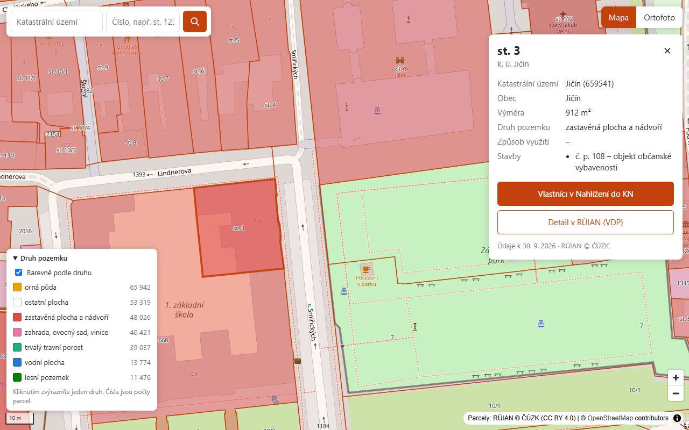
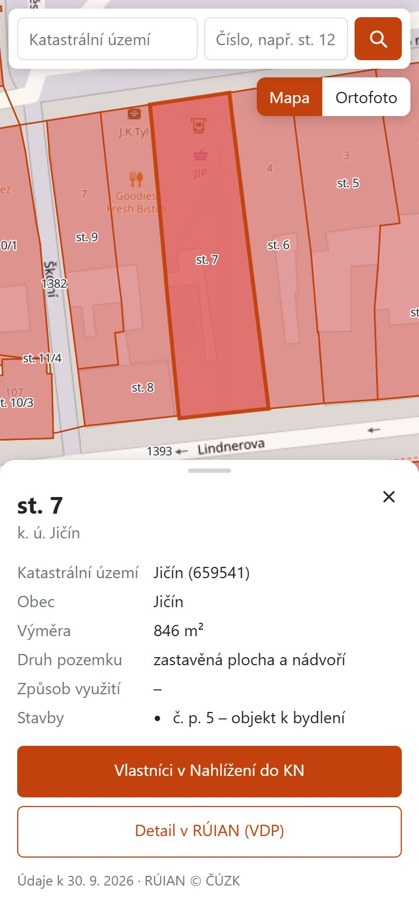

# Parcely okresu Jičín

Webová aplikácia, ktorá na mape plynulo zobrazí všetkých 271 995 parciel okresu Jičín (111 obcí) z otvorených dát
RÚIAN (ČÚZK). Po kliknutí na parcelu ukáže jej údaje a odkazy do Nahlížení do katastru a do RÚIAN.

| Desktop | Telefón |
|---|---|
|  |  |

## Rýchly štart

Predpoklady: Docker s Compose v2 (Docker Desktop alebo Docker Engine), voľné porty `8080` a `5433`, pripojenie
na internet a asi **3 GB miesta** (namerané: image 1,9 GB, databáza 0,5 GB, stiahnuté dáta 92 MB,
`vendor/` 106 MB, cache dlaždíc do ~70 MB). Lokálne PHP, PostgreSQL ani GDAL netreba.

```bash
git clone <repo>
cd parcely-jicin
cp .env.example .env
docker compose up -d --build --wait                  # prvý štart: composer install, počká, kým je hotový
docker compose exec php php bin/download.php          # stiahne VFR pre 111 obcí okresu Jičín
docker compose exec php php bin/import-codelists.php  # číselníky ČÚZK
docker compose run --rm gdal bin/import.sh            # import do PostGIS
# otvor http://localhost:8080
```

Namerané pri kontrole od nuly (čistý klon, Windows 11 + Docker Desktop; bez sťahovania imagov, to závisí od
pripojenia): štart s `composer install` 3 min 12 s, stiahnutie 113 súborov (92 MB) 72 s, číselníky 2 s,
import 53 s.

- Hodnoty v `.env` netreba meniť; `change-me` je len zástupné heslo, databáza počúva iba na `127.0.0.1`. Heslo sa
  použije pri prvom vytvorení databázy, neskoršia zmena sa prejaví až po `docker compose down -v` (zmaže aj dáta).
- `download.php` berie sadu k poslednému dňu minulého mesiaca (iný dátum: `--date=RRRRMMDD`), už stiahnuté
  súbory preskočí. Zoznam obcí je v [data/obce_okres_jicin.csv](data/obce_okres_jicin.csv), generuje ho
  `bin/list-obce.php` zo štátneho súboru a skončí s chybou, ak nevyjde 111 obcí.
- `import.sh` importuje najnovšiu stiahnutú sadu a skončí s chybou, ak z nej chýba hoci jeden súbor;
  `--obec=572659` naimportuje len jednu obec (skúška za 4 s).
- Príkazy sú rovnaké pre PowerShell aj Git Bash (kontrola od nuly bežala v Git Bash).

## Čo aplikácia vie

- Pri štarte celý okres s hranicami a názvami katastrálnych území; parcely od zoomu 13, ich čísla od zoomu 17.
- Parcely zafarbené podľa druhu pozemku, legenda s názvami z číselníka ČÚZK; klik v legende zvýrazní jeden druh.
- Klik na parcelu: číslo, KÚ, obec, výmera, druh pozemku, spôsob využitia, stavby (č. p./č. ev.), odkazy
  „Vlastníci v Nahlížení do KN“ a „Detail v RÚIAN (VDP)“.
- Zdieľateľný odkaz `http://localhost:8080/#parcel=1755256604`, funguje Späť, `Esc` zavrie detail.
- Hľadanie podľa KÚ (s našepkávaním) a čísla, napr. `Jičín` + `st. 1868/26`.
- Podklad OpenStreetMap alebo ortofoto ČÚZK; na telefóne detail ako spodný panel. Texty v aplikácii sú po česky.

## Architektúra

```
ČÚZK VFR (RÚIAN, .xml.zip, raz mesačne)
        │  bin/download.php (PHP CLI): 111 × OB_{obec}_UKSH, ST_UKSH (okres), ST_UCIS (číselníky)
        ▼
data/raw (volume raw-data)
        │  bin/import-codelists.php (PHP, XMLReader) → tabuľky cis_*
        │  bin/import.sh (kontajner gdal): ogr2ogr → schéma staging → db/transform.sql (jedna transakcia)
        ▼
PostgreSQL 18 + PostGIS 3.6: okres, obec, ku, parcel, building v EPSG:3857 (GIST), meta.vfr_date
        │
        ▼
PHP 8.3 (PHP-FPM, čisté PHP) za nginx
  GET /tiles/parcels/{z}/{x}/{y}.pbf   vektorové dlaždice cez ST_AsMVT + disková cache var/tiles/{vfr_date}
  GET /tiles/parcels.json              TileJSON: zoomy, hranice okresu, URL dlaždíc s ?v={vfr_date}
  GET /api/parcels/{id}  /api/search  /api/ku  /api/druhy-pozemku  /api/boundaries.geojson  /api/health
        │
        ▼
Frontend: HTML + CSS + JS (bez build kroku) + MapLibre GL JS 5.24.0, podklad OSM / ortofoto ČÚZK
```

Dáta sa raz mesačne stiahnu a importujú do PostGIS, nič sa neťahá z ČÚZK pri každom zobrazení. Prehliadač
dostáva len to, čo je v zábere: binárne vektorové dlaždice, ktoré PHP vyrobí jedným dotazom a uloží na disk
(dáta sa menia raz za mesiac). PHP je bez frameworku: vlastný router, kontroléry bez SQL, SQL len
v repozitároch a v `TileRenderer`, PDO s prepared statements, striktné typy.

| Služba | Image | Úloha |
|---|---|---|
| `db` | `postgis/postgis:18-3.6` | PostgreSQL 18 + PostGIS 3.6 |
| `php` | vlastný (`php:8.3.36-fpm-alpine`) | PHP-FPM s `pdo_pgsql` a OPcache |
| `web` | `nginx:1.28.3-alpine` | statické súbory, gzip, ostatné cez front controller |
| `gdal` | vlastný (`ghcr.io/osgeo/gdal:ubuntu-small-3.13.3` + `psql` 18) | import VFR, spúšťa sa len ručne |

```
bin/      CLI: zoznam obcí, sťahovanie, import číselníkov a VFR, mazanie cache, benchmark dlaždíc
data/     zoznam obcí okresu (data/raw = stiahnuté VFR vo volume)
db/       init/ = SQL pri vytvorení databázy, transform.sql = staging → tabuľky aplikácie
docker/   Dockerfile a konfigurácia PHP-FPM, nginx a GDAL
docs/     zápisník rozhodnutí, časový log, schéma VFR, snímky obrazovky
public/   front controller (index.php), frontend (index.html, assets/), písmo popiskov (fonts/)
src/      PHP (namespace Parcely\): Http, Controller, Repository, Tile, Domain, Database, Cli, Vfr, Download, Import
tests/    PHPUnit: unit testy a integračné testy proti databáze
```

## Zdroje dát

- **RÚIAN, výmenný formát VFR** ([ČÚZK](https://vdp.cuzk.gov.cz/), licencia
  [CC BY 4.0](https://creativecommons.org/licenses/by/4.0/)): sada **20260930**, číselníky 20261003. Výsledok
  importu: 111 obcí, 240 katastrálnych území, 271 995 parciel, 45 307 stavieb. Súčet výmer parciel
  (886,86 km²) sedí s plochou okresu (886,83 km²). Polia VFR a ich mapovanie: [docs/vfr-schema.md](docs/vfr-schema.md).
- **Ortofoto ČÚZK** (`ags.cuzk.gov.cz/…/ORTOFOTO_WM/MapServer`, Web Mercator).
- **OpenStreetMap** (`tile.openstreetmap.org`), pre vývoj a ukážku; reálna prevádzka by potrebovala vlastný
  zdroj podkladových dlaždíc ([pravidlá OSM](https://operations.osmfoundation.org/policies/tiles/)).
- **MapLibre GL JS 5.24.0** z unpkg, pripnutá verzia s kontrolou integrity (SRI).

## Rozhodnutia

Najdôležitejšie:

| Rozhodnutie | Dôvod | Alternatíva |
|---|---|---|
| Dáta stiahnuť, nie ťahať live | WFS ČÚZK je obmedzená počtom prvkov a územím, celý okres by plynulo nezobrazila; RÚIAN sa mení raz mesačne | Live WFS |
| VFR po obciach (`OB_{kód}_UKSH`) | Bohatšie atribúty (druh pozemku, spôsob využitia, väzba na stavby), jeden súbor za obec | INSPIRE GML po KÚ |
| PostGIS + vektorové dlaždice (MVT) z PHP | Prehliadač dostane len záber, dlaždica sa vyrobí jedným dotazom `ST_AsMVT` a cachuje; zadanie chce PHP backend | GeoJSON z PHP (272 tis. polygónov), hotový tile server (Martin, pg_tileserv) |
| Čisté PHP bez frameworku | Zadanie ho preferuje; malý router, PDO, PSR-4, striktné typy, Composer len na autoload a vývojové nástroje | Slim, Symfony |
| MapLibre GL JS 5 | Vektorové dlaždice a WebGL: plynulé aj pri tisícoch polygónov, zvýraznenie cez `feature-state`; verzia 5 má UMD balík, takže netreba bundler | Leaflet (SVG/Canvas, MVT len cez plugin) |
| Parcely od zoomu 13 | Podľa benchmarku (nižšie): najnižší zoom, kde p95 < 150 ms a najväčšia dlaždica < 500 kB | Odhad od oka |
| Vlastníci len odkazom do Nahlížení do KN | VFR údaje o vlastníkoch neobsahuje; Nahlížení do KN je chránené proti automatickému prístupu | Sťahovanie z Nahlížení |

## Výkon

```bash
docker compose exec php php bin/bench.php    # dlaždice nad celým okresom, priamo cez TileRenderer, bez cache
```

Sada 20260930 (časy a veľkosti len z dlaždíc s parcelami; z16 = náhodná vzorka 300 z 9 243; „gz“ = veľkosť
po gzipe, ktorú prehliadač naozaj stiahne):

| Zoom | Dlaždice | S dátami | p50 | p95 | max | priemer | max | max gz |
|---|---|---|---|---|---|---|---|---|
| 12 | 54 | 40 | 31,2 ms | 66,7 ms | 81,9 ms | 300 kB | **889 kB** | 565 kB |
| **13** | 176 | 126 | 18,5 ms | 27,3 ms | 52,3 ms | 101 kB | 473 kB | 309 kB |
| 14 | 630 | 437 | 6,1 ms | 15,3 ms | 29,8 ms | 32 kB | 247 kB | 169 kB |
| 15 | 2 360 | 1 615 | 2,0 ms | 5,3 ms | 19,4 ms | 10 kB | 81 kB | 58 kB |
| 16 | 300 / 9 243 | 201 | 1,0 ms | 2,7 ms | 6,5 ms | 4 kB | 18 kB | 13 kB |

- **`PARCEL_MIN_ZOOM` = 13.** Čas vykreslenia je všade hlboko pod limitom, rozhoduje veľkosť: na z12 má najväčšia
  dlaždica 889 kB. Čísla parciel sú len v dlaždiciach z16 (mapa ich kreslí od zoomu 17 z dlaždíc z16); bez toho
  by mala najväčšia dlaždica z13 628 kB a vyšiel by zoom 14.
- **Cache:** dlaždica z disku namiesto vykreslenia, merané cez nginx: z14 7,5 ms namiesto 45 ms. Plná cache
  z13–z16 by mala podľa priemerov z benchmarku asi 65 MB. Prehliadač drží dlaždice deň (`Cache-Control`,
  `ETag`, 304).
- **gzip** v nginx (úroveň 5, meraná): hranice 2,2 MB → 626 kB, najväčšia dlaždica z13 472 → 308 kB.
- **Prvé načítanie** nesťahuje žiadne parcely, len hranice a podklad; písmo popiskov je lokálne.
- **Na Windows** stojí `stat()` na bind mounte ~9 ms. Preto classmap autoloadera, OPcache bez kontroly časov
  súborov a trvalé spojenia s DB: požiadavka bez DB 5 ms, detail parcely 9 ms (predtým 0,3–1,7 s a 40 ms).

**Farby druhov pozemku.** Na mape, kde môže susediť každý druh s každým, sa dá farbou spoľahlivo rozlíšiť len
pár kategórií, aj pre ľudí s poruchou farebného videnia (overené validátorom palety). Preto majú vlastnú farbu
len hlavné druhy, príbuzné druhy farbu zdieľajú (zahrada, ovocný sad, vinice, chmelnice) a ostatní plocha
(najmä cesty) je bez výplne. Druh sa vždy dá zistiť aj inak: obrys parcely, zvýraznenie v legende, detail.

## Testy a kvalita

```bash
docker compose exec php composer test    # PHPUnit: 138 testov (unit + integračné proti DB)
docker compose exec php composer stan    # PHPStan, úroveň max
docker compose exec php composer cs      # PHP-CS-Fixer, PER-CS (composer cs:fix opraví)
```

Integračné testy prechádzajú celým API (aj tri parcely overené ručne v Nahlížení do KN) a kontrolujú
importované dáta (111 obcí, platné geometrie, použitie priestorového indexu). Bez databázy alebo bez importu sa
preskočia. `bin/import.sh` je overený cez shellcheck.

## Zápisník

**Čo ma prekvapilo**

- ČÚZK presunul súbory na doménu `vdp.cuzk.gov.cz` (stará presmeruje) a číselníky nie sú v `soucasna/` ako
  ostatné súbory, ale v `specialni/`, s dátumom 3. dňa v mesiaci.
- Viac geometrií na prvok: parcela má definičný bod, originálne hranice a hranice „OMP-V“ (tie v celom okrese
  nemá žiadna parcela).
- Oblúky: 717 parciel má v hranici kruhové oblúky (1 271 `ArcString`, 54 `Circle`), import ich aproximuje
  úsečkami.
- `ogrinfo` s JOIN nad GML zo ZIP-u nedobehol ani za 15 minút; ten istý zoznam obcí cez PHP `XMLReader` trvá 3 s.
- Bind mount z disku Windowsu: každý `stat()` ~9 ms, takže PHP stratilo pri požiadavke až 1,7 s, kým som
  nevypol kontrolu časov v OPcache a nezapol classmap.
- Nahlížení do KN chráni ochrana proti botom; dve z troch kontrolných parciel som overil ručne.
- 9 druhov pozemku sa na mape farbou rozlíšiť nedá, ani pri šiestich farbách to validátor nepustí.

**Čo by som robil ďalej alebo inak**

- Denné zmenové súbory VFR namiesto mesačnej úplnej kópie (inkrementálny import).
- CI (GitHub Actions): testy, PHPStan, CS a shellcheck pri každom pushi; testy v prehliadači (Chrome aj Firefox)
  automaticky, nie ručne.
- Nasadenie: kód zapečený v image namiesto bind mountu, vlastný zdroj podkladových dlaždíc.
- Pre celú ČR: predgenerované dlaždice (napr. PMTiles) alebo samostatný tile server pred PHP; dlaždice uložené
  rovno po gzipe.
- Hľadanie bez diakritiky (`unaccent`), zvýraznenie celého KÚ so štatistikou.


## Použitie AI

Kód, testy a dokumentáciu písal po fázach AI asistent Claude Code podľa mojich zadaní; každú fázu a rozhodnutie
som schvaľoval, kód som prešiel a viem ho vysvetliť.

## Mesačná aktualizácia

```bash
docker compose exec php php bin/download.php          # nová sada; ak ešte nie je vydaná, posledná dostupná
docker compose exec php php bin/import-codelists.php  # číselníky (ČÚZK mohol pridať kód)
docker compose run --rm gdal bin/import.sh            # import najnovšej sady, asi 1 min
docker compose exec php php bin/clear-cache.php       # zmaže cache predchádzajúcej sady
```

Import beží v jednej transakcii, takže aplikácia až do konca ukazuje starú sadu a neúspešný import ju
nepokazí. Na konci sa zmení `meta.vfr_date`: dlaždice sa odvtedy ukladajú do nového priečinka a TileJSON dá
prehliadaču URL s novým `?v=`, takže nikto nedostane dlaždicu zo starej sady a import nemusí mazať cache.
Nový kód v číselníku bez spusteného `import-codelists.php` zastaví import chybou cudzieho kľúča. Stiahnuté
súbory starších mesiacov (92 MB na mesiac) ostávajú vo volume `raw-data` a dajú sa zmazať.

## API

| Endpoint | Čo vráti |
|---|---|
| `GET /tiles/parcels/{z}/{x}/{y}.pbf` | vektorová dlaždica (MVT), vrstva `parcels`: id, `druh_pozemku_kod`, na z16 aj `label` |
| `GET /tiles/parcels.json` | TileJSON: URL dlaždíc s dátumom sady, rozsah zoomov, hranice okresu |
| `GET /api/parcels/{id}` | detail parcely vrátane stavieb, bodu a bbox (WGS 84) a odkazov do Nahlížení do KN a VDP |
| `GET /api/search?ku=Jičín&cislo=st. 1868/26` | parcely podľa KÚ (názov alebo kód) a čísla, najviac 10 |
| `GET /api/ku?q=jič` | KÚ, ktorých názov obsahuje text, najviac 10 |
| `GET /api/druhy-pozemku` | druhy pozemku v okrese s počtami parciel (legenda) |
| `GET /api/boundaries.geojson` | hranice okresu, obcí a KÚ (zjednodušené) a body pre popisky KÚ |
| `GET /api/health` | stav aplikácie a databázy |

Chyby sú JSON `{"error": "…"}` s kódom 400, 404, 405 alebo 503 (dáta ešte nie sú naimportované); neočakávané
chyby sa zapisujú do `var/log/app.log`. Bez `st.` hľadanie nájde pozemkové aj stavebné parcely, bez lomky aj
všetky poddelenia.

## Vývoj

- Po zmene PHP kódu `docker compose restart php`: OPcache nekontroluje časy súborov (pozri Výkon). Testy a CLI
  skripty vidia zmeny hneď.
- Po zmene kódu, ktorý kreslí dlaždice alebo hranice, treba zmazať aj ich cache (je verzovaná dátumom dát, nie
  kódu): `docker compose exec -u www-data php php bin/clear-cache.php --all`.
- Zmeny v `public/` sa prejavia po obnovení stránky (nginx posiela HTML, JS a CSS s `Cache-Control: no-cache`).
- Stiahnuté dáta a `var/` sú v Docker volumes (rýchlejšie ako bind mount na Windows), vypíše ich napr.
  `docker compose exec php ls data/raw`. V Git Bash treba pred príkazy s cestou `/vsizip/…` dať
  `MSYS_NO_PATHCONV=1`.

## Licencie a atribúcia

- Zdroj dát: ČÚZK, RÚIAN, licencia [CC BY 4.0](https://creativecommons.org/licenses/by/4.0/); ortofoto © ČÚZK.
- Podkladová mapa © [OpenStreetMap](https://www.openstreetmap.org/copyright) contributors.
- Písmo popiskov v `public/fonts`: glyfy Noto Sans Regular (rozsahy 0–255 a 256–511, stačia na všetky znaky
  názvov aj čísel parciel) zo servera `demotiles.maplibre.org` projektu MapLibre, stiahnuté 2026-10-31. Písmo
  © The Noto Project Authors, licencia SIL Open Font License 1.1 ([public/fonts/OFL.txt](public/fonts/OFL.txt)).
